# Diagrama de Clases UML Actualizado (MVC + SOLID + CSV)

El siguiente diagrama refleja la arquitectura refactorizada aplicando separación en capas **MVC**, principios **SOLID** y persistencia extensible en **CSV**.

```mermaid
classDiagram
    direction TB

    namespace Modelo {
        class ContenidoAudiovisual {
            <<abstract>>
            -int id
            -String titulo
            -int duracionEnMinutos
            -String genero
            +getId() int
            +getTitulo() String
            +getDuracionEnMinutos() int
            +getGenero() String
            +obtenerTipo()* String
            #obtenerDetallesEspecificos()* String
            +formatearDetalle() String
        }
        class Pelicula {
            -String estudio
            -List~Actor~ reparto
            +agregarActor(Actor) void
            +getReparto() List~Actor~
            +obtenerTipo() String
        }
        class SerieDeTV {
            -int temporadas
            -List~Temporada~ detalleTemporadas
            +agregarTemporada(int, int) void
            +getDetalleTemporadas() List~Temporada~
            +obtenerTipo() String
        }
        class Documental {
            -String tema
            -List~Investigador~ investigadores
            +agregarInvestigador(Investigador) void
            +getInvestigadores() List~Investigador~
            +obtenerTipo() String
        }
        class PodcastAudiovisual {
            -String canal
            -Investigador invitado
            +getCanal() String
            +getInvitado() Investigador
            +obtenerTipo() String
        }
        class MakingOf {
            -String director
            -Pelicula pelicula
            +getDirector() String
            +getPelicula() Pelicula
            +obtenerTipo() String
        }
        class Actor {
            -String nombre
            +getNombre() String
        }
        class Temporada {
            -int numero
            -int episodios
            +getNumero() int
            +getEpisodios() int
        }
        class Investigador {
            -String nombre
            -String especialidad
            +getNombre() String
            +getEspecialidad() String
        }
        class CatalogoAudiovisual {
            -List~ContenidoAudiovisual~ contenidos
            +agregar(ContenidoAudiovisual) void
            +eliminarPorId(int) boolean
            +buscarPorId(int) Optional~ContenidoAudiovisual~
            +buscarPorTitulo(String) List~ContenidoAudiovisual~
            +filtrarPorTipo(String) List~ContenidoAudiovisual~
            +obtenerTodos() List~ContenidoAudiovisual~
            +reemplazarTodos(List~ContenidoAudiovisual~) void
        }
        class Validador {
            <<utility>>
            +requerirTextoNoVacio(String, String) String
            +requerirPositivo(int, String) int
            +requerirNoNegativo(int, String) int
            +requerirNoNulo(T, String) T
        }
    }

    namespace Persistencia {
        class LectorContenidos {
            <<interface>>
            +cargar(Path) List~ContenidoAudiovisual~
        }
        class EscritorContenidos {
            <<interface>>
            +guardar(Path, List~ContenidoAudiovisual~) void
        }
        class AdaptadorCsvContenido {
            <<interface>>
            +obtenerTipo() String
            +soporta(ContenidoAudiovisual) boolean
            +prioridadEscritura() int
            +aColumnas(ContenidoAudiovisual) String[]
            +desdeColumnas(String[], ContextoCargaCsv) ContenidoAudiovisual
        }
        class RepositorioContenidoCsv {
            -List~AdaptadorCsvContenido~ adaptadores
            +crearPorDefecto() RepositorioContenidoCsv
            +cargar(Path) List~ContenidoAudiovisual~
            +guardar(Path, List~ContenidoAudiovisual~) void
        }
        class AdaptadorPeliculaCsv
        class AdaptadorSerieCsv
        class AdaptadorDocumentalCsv
        class AdaptadorPodcastCsv
        class AdaptadorMakingOfCsv
        class ContextoCargaCsv {
            +obtenerOCrearActor(String) Actor
            +obtenerOCrearInvestigador(String, String) Investigador
            +registrarPelicula(Pelicula) void
            +buscarPeliculaPorId(int) Optional~Pelicula~
        }
        class UtilidadCsv {
            <<utility>>
            +formatearLinea(String[]) String
            +parsearLinea(String) String[]
            +parsearEntero(String, String) int
        }
        class PersistenciaException {
            <<exception>>
        }
    }

    namespace Vista {
        class VistaAudiovisual {
            <<interface>>
            +mostrarBienvenida() void
            +mostrarMenu() void
            +leerOpcion() int
            +leerTexto(String) String
            +leerEntero(String) int
            +mostrarMensaje(String) void
            +mostrarError(String) void
            +mostrarContenidos(List~ContenidoAudiovisual~) void
        }
        class VistaConsola {
            -Scanner entrada
            -PrintStream salida
        }
    }

    namespace Controlador {
        class ControladorAudiovisual {
            -CatalogoAudiovisual catalogo
            -LectorContenidos lector
            -EscritorContenidos escritor
            -VistaAudiovisual vista
            -Path rutaPorDefecto
            +iniciar() void
            +procesarOpcion(int) boolean
        }
        class Aplicacion {
            +main(String[]) void
        }
    }

    ContenidoAudiovisual <|-- Pelicula
    ContenidoAudiovisual <|-- SerieDeTV
    ContenidoAudiovisual <|-- Documental
    ContenidoAudiovisual <|-- PodcastAudiovisual
    ContenidoAudiovisual <|-- MakingOf

    Pelicula "0..*" o-- "0..*" Actor : agregacion
    SerieDeTV "1" *-- "0..*" Temporada : composicion
    Documental "0..*" --> "0..*" Investigador : asociacion
    PodcastAudiovisual "0..*" --> "1" Investigador : invitado
    MakingOf "0..*" --> "1" Pelicula : complementa
    CatalogoAudiovisual "1" o-- "0..*" ContenidoAudiovisual : gestiona

    LectorContenidos <|.. RepositorioContenidoCsv
    EscritorContenidos <|.. RepositorioContenidoCsv
    AdaptadorCsvContenido <|.. AdaptadorPeliculaCsv
    AdaptadorCsvContenido <|.. AdaptadorSerieCsv
    AdaptadorCsvContenido <|.. AdaptadorDocumentalCsv
    AdaptadorCsvContenido <|.. AdaptadorPodcastCsv
    AdaptadorCsvContenido <|.. AdaptadorMakingOfCsv
    RepositorioContenidoCsv "1" o-- "1..*" AdaptadorCsvContenido : delega
    RepositorioContenidoCsv ..> ContextoCargaCsv : usa
    RepositorioContenidoCsv ..> UtilidadCsv : usa
    RepositorioContenidoCsv ..> PersistenciaException : lanza

    VistaAudiovisual <|.. VistaConsola

    ControladorAudiovisual --> CatalogoAudiovisual : actualiza
    ControladorAudiovisual --> LectorContenidos : inyeccion DIP
    ControladorAudiovisual --> EscritorContenidos : inyeccion DIP
    ControladorAudiovisual --> VistaAudiovisual : inyeccion DIP
    Aplicacion ..> ControladorAudiovisual : ensambla
    Aplicacion ..> RepositorioContenidoCsv : instancia
    Aplicacion ..> VistaConsola : instancia
```

## Resumen de relaciones y principios aplicados

- **Herencia y LSP:** `Pelicula`, `SerieDeTV`, `Documental`, `PodcastAudiovisual` y `MakingOf` heredan de `ContenidoAudiovisual` y cumplen de forma uniforme el contrato `obtenerTipo()` / `formatearDetalle()`.
- **Agregación, Composición y Asociación:** `Pelicula` agrega `Actor`; `SerieDeTV` compone `Temporada` (constructor package-private); `Documental` y `PodcastAudiovisual` se asocian con `Investigador`; `MakingOf` se asocia con `Pelicula`.
- **OCP en Persistencia:** `RepositorioContenidoCsv` delega en adaptadores `AdaptadorCsvContenido`, permitiendo soportar nuevos tipos de contenido sin modificar el repositorio.
- **ISP y DIP:** `LectorContenidos`, `EscritorContenidos` y `VistaAudiovisual` separan responsabilidades y son inyectados en `ControladorAudiovisual` desde `Aplicacion`.
